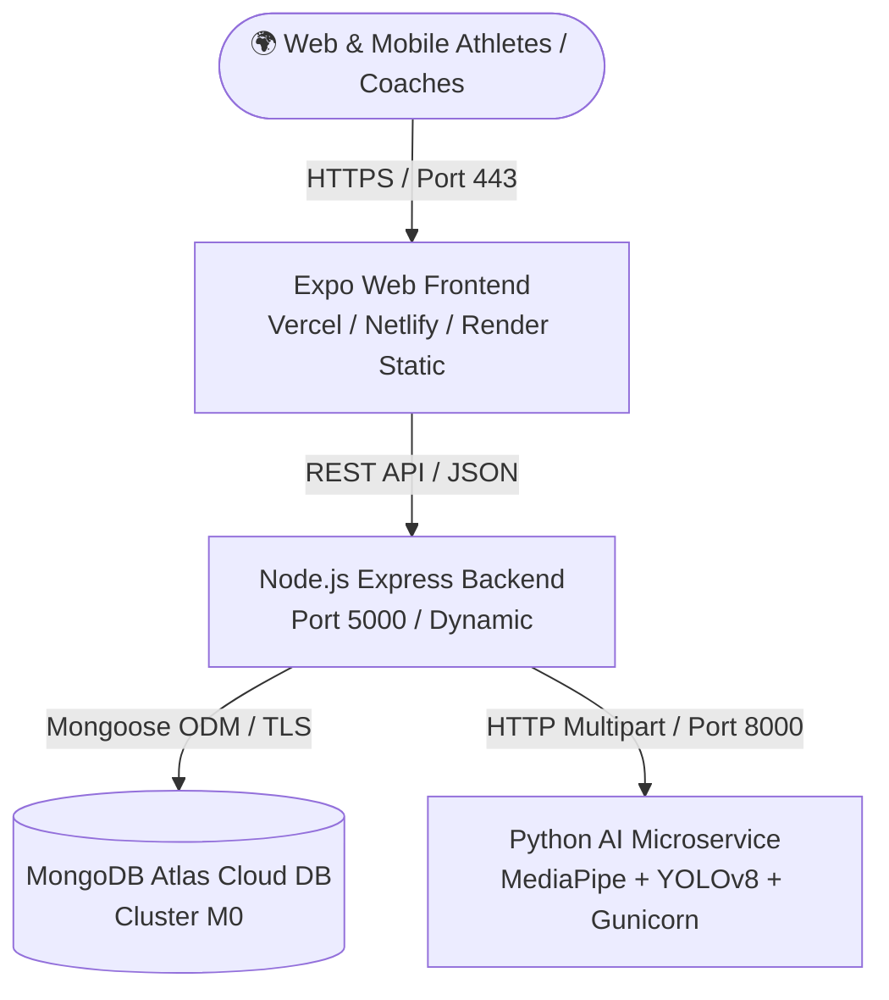

# 🚀 ScoutX-AI Production Deployment Guide

A complete, production-ready guide to deploying the **ScoutX-AI** platform online so users, athletes, coaches, and scouts worldwide can access the application 24/7 independently of any local development laptop.

---

## 🏗️ System Architecture

ScoutX-AI is structured into 4 modular microservices:



| Service | Technology | Recommended Host | Free Tier Compatible? |
| :--- | :--- | :--- | :--- |
| **Frontend** | React Native, Expo Web, Nginx | Vercel, Netlify, or Render Static | ✅ Yes (100% Free, Unlimited Bandwidth) |
| **Backend** | Node.js, Express, Multer, JWT | Render, Railway, Fly.io, or VPS | ✅ Yes (Render Free Plan) |
| **AI Vision Engine** | Python 3.10, Flask, OpenCV, MediaPipe, YOLOv8 | Render, Railway, Fly.io, or VPS | ✅ Yes (Render Free Plan with 1-Worker WSGI) |
| **Database** | MongoDB 7.0 | MongoDB Atlas | ✅ Yes (M0 Sandbox: 512 MB Free Forever) |

---

## 📋 Production Environment Variables Checklist

### 1. Backend (`scoutx-backend`)
| Variable | Value / Example | Description |
| :--- | :--- | :--- |
| `NODE_ENV` | `production` | Enables production security checks and disables ephemeral fallback |
| `PORT` | `5000` *(or provided dynamically by host)* | Express listening port |
| `MONGO_URI` | `mongodb+srv://<user>:<password>@cluster0.xxx.mongodb.net/scoutx_db?retryWrites=true&w=majority` | MongoDB Atlas cluster connection string |
| `JWT_SECRET` | `64+ character random string` | Secret used to sign user authentication tokens |
| `AI_SERVICE_URL` | `https://scoutx-ai-service.onrender.com` | Public or internal URL of the deployed Python AI service |
| `CLIENT_ORIGIN` | `https://scoutx-frontend.onrender.com,https://scoutx.vercel.app` | Comma-separated allowed browser origins for CORS |
| `ADMIN_EMAILS` | `admin@scoutx.com,ganeshmundhe815@gmail.com` | Approved admin emails for management console |
| `ADMIN_AUTH_CODE`| `SCOUTX-ADMIN-PROD-2025` | Security passcode for admin registration |

### 2. Python AI Service (`scoutx-ai-service`)
| Variable | Value / Example | Description |
| :--- | :--- | :--- |
| `PORT` | `8000` *(or dynamic `$PORT`)* | Microservice port |
| `PYTHONUNBUFFERED` | `1` | Real-time console logging |
| `YOLO_MODEL_PATH` | `yolov8n.pt` | Lightweight nano football detection model |

### 3. Frontend (`scoutx-frontend`)
| Variable | Value / Example | Description |
| :--- | :--- | :--- |
| `EXPO_PUBLIC_API_URL` | `https://scoutx-backend.onrender.com/api` | Full URL to backend gateway (always resolves `/api`) |
| `EXPO_NO_TELEMETRY` | `1` | Disables interactive telemetry prompts during CI build |

---

## 🗄️ Step 1: Set Up MongoDB Atlas (Free Cloud Database)

1. Go to [MongoDB Atlas](https://www.mongodb.com/cloud/atlas) and log in or create an account.
2. Click **Create a Deployment** and select the **M0 Free (Shared)** tier.
3. Choose a cloud region close to your users (e.g. `ap-south-1` Mumbai or `us-east-1`).
4. Under **Security & Network Access**:
   - **Database Access**: Create a new database user (e.g., `scoutx_admin`) with password authentication. Save the password.
   - **Network Access**: Add an IP access entry: `0.0.0.0/0` (Allow Access from Anywhere) so cloud hosting platforms (Render, Railway, etc.) can reach the database.
5. In **Database Deployments**, click **Connect** -> **Drivers** -> **Node.js**:
   - Copy your connection string:
     ```text
     mongodb+srv://scoutx_admin:<password>@cluster0.xxxx.mongodb.net/scoutx_db?retryWrites=true&w=majority
     ```
   - Replace `<password>` with your actual password and ensure the DB name is `scoutx_db`.

> [!NOTE]
> When your backend starts up with this `MONGO_URI`, it automatically detects an empty database and pre-seeds the official demo accounts (`player@scoutx.com`, `coach@scoutx.com`, `admin@scoutx.com`, `ganeshmundhe815@gmail.com`) with password `password123`.

---

## 🚀 Option A: 1-Click Deployment via Render Blueprint (Recommended)

The repository includes a battle-tested [`render.yaml`](file:///render.yaml) file that automatically configures all 3 services in one click.

1. Push your repository to GitHub: `https://github.com/ganeshmundhe815/ScoutX-AI`.
2. Log into [Render.com](https://render.com).
3. From the dashboard, click **New +** -> **Blueprint**.
4. Connect your GitHub repository `ganeshmundhe815/ScoutX-AI`.
5. Render detects `render.yaml` and displays the blueprint services:
   - `scoutx-backend` (Node.js Web Service)
   - `scoutx-ai-service` (Python Web Service)
   - `scoutx-frontend` (Static Site with CDN)
6. In the environment parameter prompt, enter your `MONGO_URI` from MongoDB Atlas.
7. Click **Apply**. Render will automatically build and deploy all services!

---

## 🌐 Option B: Hybrid Cloud Deployment (Vercel Frontend + Render/Railway Backend)

For maximum performance, host the frontend static export on Vercel or Netlify (instant global CDN edge servers) while running the backend and AI microservice on Render or Railway.

### Frontend on Vercel
1. Log into [Vercel](https://vercel.com).
2. Click **Add New...** -> **Project** -> Import `ScoutX-AI`.
3. In **Root Directory**, edit and select `frontend`.
4. Vercel automatically detects [`vercel.json`](file:///frontend/vercel.json):
   - Build Command: `npx expo export -p web`
   - Output Directory: `dist`
5. Under **Environment Variables**, add:
   - `EXPO_PUBLIC_API_URL`: `https://scoutx-backend.onrender.com/api`
   - `EXPO_NO_TELEMETRY`: `1`
6. Click **Deploy**.

### Backend on Render / Railway
- **Root Directory**: `backend`
- **Build Command**: `npm install --production`
- **Start Command**: `npm start`
- **Environment Variables**: See Backend Checklist above.

### AI Service on Render / Railway
- **Root Directory**: `ai_service`
- **Build Command**: `pip install -r requirements.txt`
- **Start Command**: `gunicorn --bind 0.0.0.0:$PORT --workers 1 --threads 4 --timeout 180 app:app`
- **Environment Variables**: `PYTHONUNBUFFERED=1`, `YOLO_MODEL_PATH=yolov8n.pt`

> [!IMPORTANT]
> **Memory Sizing for Python AI Service**:
> The AI service utilizes PyTorch, Ultralytics YOLOv8n, and MediaPipe Lite. Baseline memory usage is ~350 MB RAM.
> On Render's 512 MB free tier, running multiple Gunicorn workers (`--workers 2`) will trigger an Out-Of-Memory (OOM) `SIGKILL`.
> Always use `--workers 1 --threads 4` on 512 MB instances. For high concurrency, upgrade to an instance with 1 GB - 2 GB RAM.

---

## 🐳 Option C: Production Docker Deployment (Self-Hosted / VPS)

If hosting on a Linux VPS (Ubuntu, Debian, AWS EC2, DigitalOcean Droplet):

1. Install Docker and Docker Compose on your server:
   ```bash
   sudo apt-get update && sudo apt-get install -y docker.io docker-compose
   ```
2. Clone your repository:
   ```bash
   git clone https://github.com/ganeshmundhe815/ScoutX-AI.git
   cd ScoutX-AI
   ```
3. Set your production environment variables:
   ```bash
   cp .env.production.example .env
   # Edit .env with your domain names and secrets
   ```
4. Build and start all 4 containers in detached mode:
   ```bash
   docker-compose up -d --build
   ```
5. Verify container health:
   ```bash
   docker-compose ps
   ```

---

## 🔍 Verification & Health Checks

Once deployed, verify each service using its public health endpoint:

### 1. Python AI Microservice Health
```bash
curl -s https://scoutx-ai-service.onrender.com/health
```
**Expected Response:**
```json
{
  "status": "ok",
  "service": "ScoutX AI Universal Football Computer Vision Engine ⚽🧠",
  "supportedDrills": ["dribbling", "shooting", "ball_control"],
  "models": {
    "pose": "MediaPipe 33-Landmark PoseLandmarker (Lite)",
    "yolo": "yolov8n.pt",
    "yoloResolution": "320x320 optimized for CPU",
    "tracker": "2D Kalman Filter Motion Smoother"
  },
  "python": "3.10.x",
  "port": 8000
}
```

### 2. Backend Gateway Health
```bash
curl -s https://scoutx-backend.onrender.com/api/health
```
**Expected Response:**
```json
{
  "status": "success",
  "message": "ScoutX AI Backend API is running smoothly 🚀",
  "database": {
    "status": "connected",
    "engine": "MongoDB",
    "readyState": 1
  },
  "aiMicroservice": {
    "status": "online",
    "online": true,
    "latencyMs": 45
  }
}
```

### 3. Frontend Web Verification
1. Open your frontend URL (e.g. `https://scoutx-frontend.onrender.com` or `https://scoutx.vercel.app`).
2. Log in with demo credentials:
   - **Player**: `player@scoutx.com` / `password123`
   - **Coach**: `coach@scoutx.com` / `password123`
   - **Admin**: `admin@scoutx.com` / `password123`
3. Navigate to **Assessment**, select **Dribbling**, upload a video, and verify real-time processing and scorecard calculation!

---

## 🛠️ Troubleshooting

| Issue | Root Cause | Solution |
| :--- | :--- | :--- |
| `Production MongoDB connection failed` | Missing or invalid `MONGO_URI`, or IP not whitelisted | In MongoDB Atlas, add `0.0.0.0/0` under Network Access and verify credentials in connection URI. |
| `AI Computer Vision service is offline` | Incorrect `AI_SERVICE_URL` in backend env | Ensure backend env `AI_SERVICE_URL` points to `https://scoutx-ai-service.onrender.com` without a trailing `/api`. |
| `CORS Error: No 'Access-Control-Allow-Origin'` | Frontend domain not recognized | Add your frontend URL to backend's `CLIENT_ORIGIN` environment variable. |
| `Worker was killed by signal 9 (SIGKILL)` | Python service ran out of memory (OOM) | Ensure Gunicorn start command uses `--workers 1 --threads 4` rather than multiple workers. |
| `Failed to fetch` on login / social auth | Frontend calling localhost instead of cloud backend | Verify `EXPO_PUBLIC_API_URL` is set to `https://scoutx-backend.onrender.com/api` during frontend build. |
